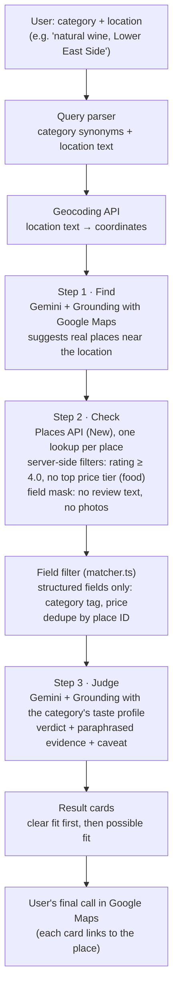

# Architecture

## The search path

## What each part does

| Part | File | What it does |
|---|---|---|
| Query parser | `src/query-parser.ts` | Matches the category from a fixed synonym list (with a small typo tolerance) and keeps the rest as location text. No extra model call. |
| Category config | `src/category-config.ts` | One entry per category: search phrases, radius and taste profile. |
| Taste profiles | `src/taste-profiles.ts` | Plain-language criteria per category. This text is the input to Step 3. |
| Step 1 | `src/search-pipeline.ts` | One Gemini call with the Google Maps tool, biased to the location. |
| Step 2 | `src/places-client.ts` | Places API (New) lookup per candidate, with `minRating` and `priceLevels` on the request, so Google's server applies them. |
| Field filter | `src/matcher.ts` | Rules on structured fields only (for example, a sushi price check). It reads no review text. |
| Step 3 | `src/scoreCandidate.ts` | One Gemini call per place, with Grounding. It returns a verdict (`strong_match`, `possible_match`, `not_a_match`), two paraphrased observations and a caveat. Quotation marks are banned. |
| Streaming | `src/search-pipeline-stream.ts`, `app/alt/` | The same pipeline, sending each scored place to the `/alt` page as soon as it is ready. |
| Spend protection | `src/spend-gate.ts`, `src/quota-gate.ts`, `src/deadline.ts`, `src/call-timeout.ts` | Reservation gate, caps, per-call timeouts and a request deadline. Built and tested locally, not deployed. |

## What is stored, and what is not

| Data | Stored? |
|---|---|
| Place ID | Yes. This is Google's documented exception. |
| Whether a result was viewed | Yes (an app-state flag). |
| The search as typed (category and location text) | Yes. This is the user's own input, not Google content. |
| Call counts and costs per search, spend reservations | Yes (for spend protection). |
| Place names, addresses, ratings, prices | No. Displayed as returned, never written to the database. |
| Review text, editorial summaries, photos | No. Never requested from the API. |
| Model output (verdicts, evidence) | No. Displayed only. |

Schema: [`schema/schema.sql`](../schema/schema.sql).

## Why it is built this way

- **Gemini with Grounding for every judgment that needs reviews.** Under Google's terms, this is the named way to have a model reason over Google Maps content. See decision 2 in [DECISIONS.md](../DECISIONS.md).
- **Filters on Google's server, not in the app.** A rating or price filter applied by Google's own server is not the app creating new content from Google's data.
- **Paraphrase only.** Grounded citations point to places, not reviews, so quotes can't be checked. See decision 3.
- **A short Step 1 list, then one scoring call per place.** One place per call means one failed call loses one place, not a whole batch.

## Not wired yet

- **Discovery merge.** Several generated "niche angles" per search, merged by place ID. Validated in experiments for art and wine, not wired into the live search path.
- **Fallback tiers.** A relaxation ladder exists in `src/search-orchestrator.ts`. It stopped working when rating filtering moved to Google's server, and nothing in the live path uses it.
